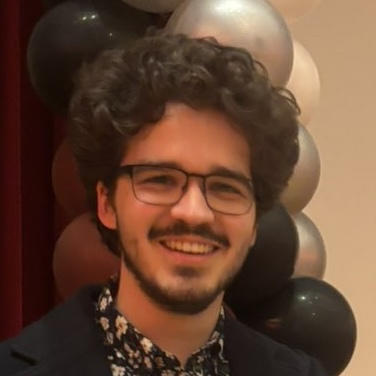

{:style="float: right; max-width: 35%; margin: 0 0 2rem 2rem"}

Hello! Whatever your reason for visiting this page, welcome. I'm glad you're here. Here's a (hopefully) not too outdated photo of me! Hair length varies slightly.

I hope this site will become a collection of many things, ranging from explorations in programming, photography, cooking, reading, and whatever other hobbies I pick up in life.

## Professional Details
- B.S. in Computer Engineering from the University of Massachusetts Amherst
- Currently a student Full Stack Engineer at [UMass Transit](https://umass.edu/bus)
- Previously a Software Engineer Intern at [Stellar Science](https://www.stellarscience.com/)
- Software Lead on [Recalling Instruments For Fun](https://websites.umass.edu/ece-sdp/sdp26-team-30/)
  - Student Choice and 2nd Place Faculty Choice for UMass ECE SDP 2026

## Programming Expertise

I primarily study and work with Linux systems, including scripting and low-level programming. Currently I am focused on improving my parallelization abilities.
I also have significant experience with [Ruby on Rails](https://rubyonrails.org/)!
